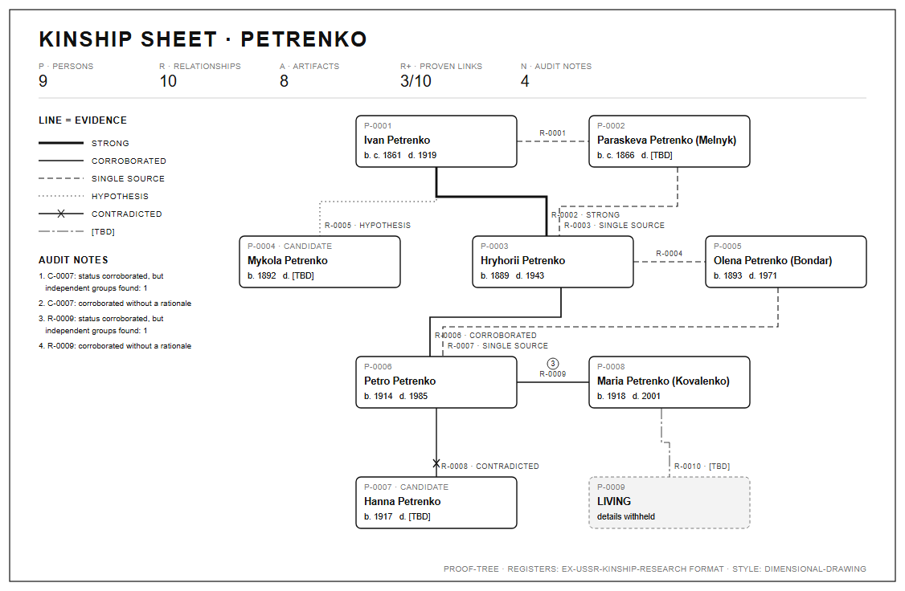
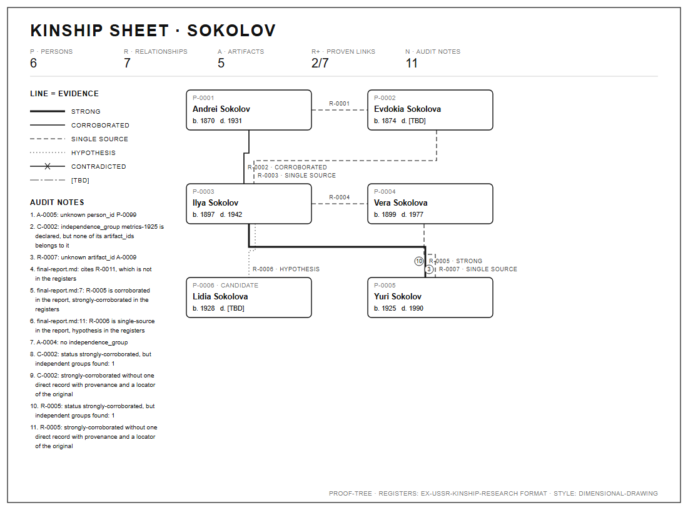
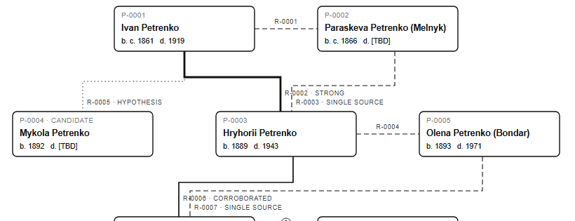

<div align="center">

# proof-tree

**Draw your family tree so every line shows how well it is proven, from your research notes.**

Most family trees draw a guess and a baptism record with the same line. proof-tree draws them the way Apple draws its dimensional drawings: one calm sheet, where line weight and dashes tell a proven link from a forum rumour.

 

Works with **Claude Code** and **Codex**.



</div>

## Quick start
```bash
git clone https://github.com/Dodai0419/proof-tree && cd proof-tree
python proof_tree.py examples/petrenko -o tree.svg
```
```
Case: .../examples/petrenko
Records: persons=9, artifacts=8, claims=7, relationships=10
- relationships: contradicted=1, corroborated=2, hypothesis=1, single-source=4, strongly-corroborated=1, unresolved=1; not corroborated: 7

WARNINGS:
- C-0007: status corroborated, but independent groups found: 1
- R-0009: status corroborated, but independent groups found: 1
...
wrote tree.svg
```
Python 3.8+ and the standard library. No install, no network. Open `tree.svg` in a browser or put it in a README.

## Gallery

| Case | Sheet |
|---|---|
| **A clean case.** Three generations of a fictional family. Ivan → Hryhorii is a birth entry plus a marriage record (heavy line). Ivan → Mykola is only a forum tree (dotted). Petro → Hanna is crossed out: the record would make the father three years old. |  |
| **A case with mistakes.** The audit finds a person ID that does not exist, an independence group with no source behind it, and a final report that calls R-0005 "corroborated" while the registers say "strongly-corroborated". Each note is numbered, and the number sits on the line it is about. |  |
| **Up close.** Two parents, two lines into one child: the father's link is proven by two independent records, the mother's by one. You see which side needs more research without reading a table. |  |

The full text output for the second case is in [docs/sokolov-audit.txt](docs/sokolov-audit.txt).

## The problem
- Family trees online show every link as equally true, so a guess copied from a forum looks as solid as a church record.
- Careful researchers keep evidence registers (who, which source, which claim), but a CSV does not show you the weak branches.
- Status words drift: the final report says "corroborated" while the registers say "single source", and nobody notices.

## The solution
| Idea | Fixes |
|------|-------|
| **Line = evidence.** Six line styles: heavy, solid, dashed, dotted, crossed, dash-dot `[TBD]`. Grey only, so it prints and photocopies. | A guess no longer looks like a record. |
| **The audit runs first.** Unknown IDs, independence groups with no artifact behind them, "corroborated" with one source, report statuses that disagree with the registers. Same checks, same order as ex-ussr-kinship-research. | Over-claimed links are caught before you share the tree. |
| **Notes sit on the lines.** Every finding gets a number; the number is drawn on the relationship it is about. | You see where the problem is, not just that there is one. |
| **Living people are redacted.** `living_status = living` shows the ID only. Unknown dates show `[TBD]`, never a guess. | Safe to post; nothing invented. |

## Line styles

| Status | Line | Meaning |
|---|---|---|
| `strongly-corroborated` | heavy solid | two or more independent sources, at least one direct original record |
| `corroborated` | solid | two or more independent sources |
| `single-source` | dashed | one source |
| `hypothesis` | dotted | a lead, not a record |
| `contradicted` | solid with an X | sources disagree |
| `unresolved` / empty | dash-dot, `[TBD]` | not researched yet |

## Your own case
Copy the header rows of `examples/petrenko/*.csv` (they are the columns of ex-ussr-kinship-research's `assets/` templates) and add one row per person, source, claim and relationship. Then:
```bash
python proof_tree.py my-case --audit          # fix errors first
python proof_tree.py my-case -o my-case.svg   # then draw
```
`--json` prints the audit as JSON. `--strict` also fails on warnings. The exit code is 1 when the audit finds errors, like the original script.

## FAQ

**Do I need the ex-USSR skill to use this?**
No. The registers are plain CSV files; the column names come from that project, but nothing in proof-tree is specific to the former USSR. Any family, any country.

**What is an "independence group"?**
Two copies of the same record (a scan and a transcription, or two websites quoting one book) are one source, not two. Give them the same `independence_group`. A link counts as corroborated only when its sources belong to at least two groups, and a group counts only when an artifact in the registers actually belongs to it.

**Why grey only?**
It is the house rule of dimensional-drawing, and it means the sheet survives a black-and-white printer and a photocopy at a family reunion. Status is carried by line weight and dashes, so nothing depends on telling colours apart.

**Can I share the sheet publicly?**
Living people are drawn as a grey box with their ID only, and their names and dates never enter the SVG. Check the rest of your registers before you post: proof-tree does not decide who counts as living, the `living_status` column does.

**My tree has a cycle / a person is their own ancestor.**
That is a data error, but the layout will not hang on it: generations are computed with a bounded number of passes.

**What does exit code 1 mean?**
The audit found errors (broken references or report statuses that disagree with the registers). The sheet is still written so you can see where they are. Use `--strict` to fail on warnings too, for example in CI.

## Use with Claude Code
```bash
/plugin marketplace add Dodai0419/proof-tree
/plugin install proof-tree@proof-tree
```
Then ask: *"Draw my family tree from ./case and tell me which links are weakest."*

## Use with Codex (ChatGPT)
```bash
git clone https://github.com/Dodai0419/proof-tree && cp -r proof-tree/skills/* ~/.codex/skills/
```
Or copy `AGENTS.md` into your project root.

## Benchmarks
Same case (`examples/sokolov`, 6 persons, 7 relationships, a final report), Windows 11, Python 3.11.1, `python bench/bench.py <ex-ussr-kinship-research clone> 20`, run 3 times.

| | ex-ussr-kinship-research `audit_evidence.py` (3ee61a5) | proof-tree |
|---|---|---|
| audit findings on both example cases | 6 errors, 9 warnings | the same record IDs in the same order (`tests/fixtures/upstream_audit.json`) |
| audit code, non-blank non-comment lines | 365 | 163 |
| audit wall time per run (median of 20) | 233-555 ms | 286-307 ms (audit only), 257-263 ms (audit + SVG) |
| draws the tree | no (text or JSON report) | yes, one SVG |
| dependencies | standard library | standard library |

Wall time is mostly Python start-up and varies a lot on this machine, so there is no speed claim: both take a few hundred milliseconds. The audit is less than half the code.

## Inspired by
- [DenisSergeevitch/ex-ussr-kinship-research](https://github.com/DenisSergeevitch/ex-ussr-kinship-research) — the register format, the evidence statuses and the audit rules (ported).
- [enesozturk/dimensional-drawing](https://github.com/enesozturk/dimensional-drawing) — the sheet style: monochrome, line weights instead of colours, `[TBD]` for unknowns.

## Roadmap
- [ ] Import GEDCOM files into the registers (relationships start as `unresolved`).
- [ ] Sibling and godparent links.
- [ ] A4 PDF export.

## License
MIT. Portions from the two projects above, see [NOTICE](NOTICE). The example families are fictional.
